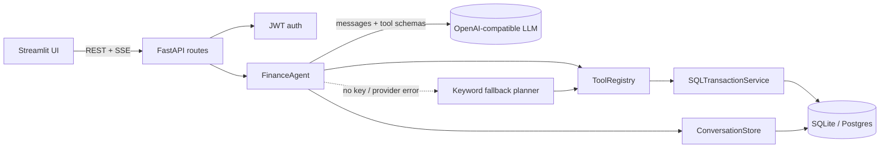

# Personal Finance Agent

[](https://github.com/Parth-Babariya/Personal-Finance-Agent/actions/workflows/ci.yml)
[](https://www.python.org/)

An LLM tool-calling agent for personal finance. Users track income and expenses through a REST API or a
Streamlit UI, then ask questions in plain language ("did I spend more on food than last month?", "I spent
450 on lunch"). The agent decides which tools to call, queries only that user's data, and answers with
numbers taken from the database.

## Highlights

- **Tool-calling agent loop.** The LLM picks from 11 typed tools, sees their results, and writes the answer.
  It can call several tools in one step and supports multi-step reasoning with a step budget.
- **Budgets, goals and analytics.** Monthly category budgets with alerts and month-end projections,
  savings goals checked against the user's real saving rate, monthly trends, unusual-expense detection
  and recurring-payment (subscription) detection, each with an explainable reason.
- **Bank statement import.** Upload a CSV from your bank; rows are parsed, categorised by keyword rules and
  then the LLM, checked for duplicates, and saved only after you review them.
- **Guardrails.** Writes need user confirmation, money figures in replies are checked against tool
  results at runtime, card/Aadhaar/PAN numbers are masked before reaching the LLM, and rate limits plus a
  daily token budget cap abuse and cost. Details in [Guardrails](#guardrails).
- **Streaming.** `POST /chat/stream` sends Server-Sent Events: tool calls as they happen, then answer tokens.
- **Multi-turn memory.** Conversation history is stored in SQL per user, so follow-ups like "and last
  month?" work.
- **Works without an LLM.** A deterministic keyword planner uses the same tools when no API key is set or
  the provider fails. It never re-runs a write the LLM already made.
- **Any OpenAI-compatible provider.** OpenAI, Groq, Gemini or Ollama, selected with `OPENAI_BASE_URL`.
- **Eval harness.** 41 cases (summaries, comparisons, lookups, writes, multi-turn, planning, guardrails). Each
  reply is checked against ground truth computed from the database. See [evals/RESULTS.md](evals/RESULTS.md).
- **Solid basics.** Money stored as `Numeric(12,2)`, income and expense types, real date-range periods,
  full transaction CRUD with filters, Alembic migrations, 208 tests on an isolated in-memory
  database, and lint plus migration checks in CI.

## Architecture



One chat turn:

1. Load the user's last N messages from `chat_messages`.
2. Send the system prompt (today's date, currency, rules), the history, the user's message and the tool
   schemas to the LLM.
3. If the model requests tools, validate the arguments, run them in a worker thread scoped to the
   authenticated user, append the results, and call the model again. Stop at a text answer or after
   `AGENT_MAX_STEPS`; when the budget runs out, the model must answer without tools.
4. Save the user message and the reply (with the names of the tools used), and emit a final `done` event
   with the tool trace, latency and token usage.

### Tools

| Tool | Purpose |
|---|---|
| `get_spending_summary` | Expenses, income, net and per-category totals for a period or date range |
| `compare_periods` | Two periods side by side, with the change overall and per category |
| `search_transactions` | Filter by text, category, type, amount range and dates |
| `get_top_expenses` | Largest expenses in a period |
| `get_insights` | Rule-based observations (top category, large purchases, savings rate) |
| `add_transaction` | Propose an expense or income from natural language; saved only after the user confirms |
| `check_budget` | Budget usage per category: spent, remaining, state (ok / warning / over), month-end projection |
| `get_monthly_trend` | Month-by-month income, expense and net, optionally for one category |
| `find_unusual_spending` | Expenses far above the user's norm for that category or overall, with a reason |
| `find_recurring_payments` | Subscriptions and regular bills with typical amount and next expected date |
| `get_savings_goals` | Goal progress, required saving per month, on-track status and projected completion |

Periods: `today`, `this_week`, `last_7_days`, `this_month`, `last_month`, `last_30_days`, `this_year`,
`last_year`, `all_time`, or explicit `start_date`/`end_date`.

## Guardrails

| Risk | Guardrail |
|---|---|
| Model reads another user's data | `user_id` comes from the JWT via `ToolContext`; it is not a tool argument, so no prompt can change it |
| Malformed or out-of-range tool calls | Pydantic validation (enums, ranges, no future dates, no extra fields); errors go back to the model |
| Misread message adds a wrong transaction | `add_transaction` creates a pending action (15 min expiry); saved only after "yes" or the Confirm button; possible duplicates flagged; max 3 writes per message |
| Invented numbers | After each LLM reply, every currency figure must match a tool result, the conversation, or a sum/difference of tool numbers; one corrective retry, then a visible warning |
| Sensitive identifiers sent to the provider | Card numbers (Luhn-checked), Aadhaar, PAN, phone, email/UPI and account numbers masked before the LLM call and before storage |
| Runaway loops or slow providers | Step budget with a forced final answer, max tool calls per step, and an overall deadline (`AGENT_TIMEOUT_SECONDS`) with fallback |
| Cost abuse and brute force | Per-user chat rate limit, per-IP auth limit, lockout after repeated failed logins, daily LLM token budget per user (then fallback) |
| Instructions hidden in imported statements | Descriptions are sanitised and truncated; the categoriser and the agent treat them as data; LLM labels are validated against the category list; covered by an eval case |
| Off-topic requests and advice | System prompt scopes the assistant to budgeting and declines investment, tax or legal advice; covered by eval cases |

The rate limiter is in-process; with several API replicas it should move to a shared store such as Redis.

## Quick start

```bash
python -m venv .venv && .venv\Scripts\activate      # source .venv/bin/activate on macOS/Linux
pip install -r requirements-dev.txt
copy .env.example .env                               # then add your key; loaded automatically
uvicorn src.api.app:app --port 8003 --reload         # API + docs at http://localhost:8003/docs
streamlit run src/ui/app.py                          # UI at http://localhost:8501
```

`.env.example` is set up for [Groq](https://console.groq.com/keys) (free tier, supports tool calling): paste
your key into `OPENAI_API_KEY` in `.env`. OpenAI, Gemini and Ollama blocks are included too. Leave the key
empty to run with the keyword fallback. Variables already set in the environment override `.env`.

For production, set `APP_ENV=production` (the app then refuses to start without `JWT_SECRET_KEY`), point
`DATABASE_URL` at Postgres, set `AUTO_CREATE_TABLES=false`, and run `alembic upgrade head`.

## API

| Method | Path | Description |
|---|---|---|
| POST | `/api/v1/auth/signup`, `/api/v1/auth/login` | Get a JWT |
| POST | `/api/v1/transactions` | Add an expense or income |
| GET | `/api/v1/transactions` | List, with `period`/`start_date`/`end_date`/`category`/`type`/`q`/pagination |
| GET / PATCH / DELETE | `/api/v1/transactions/{id}` | Read, partially update, delete |
| GET | `/api/v1/summary` | Totals for a period or date range |
| POST | `/api/v1/chat` | Agent reply, plus the tool trace, mode, pending actions and grounding report |
| POST | `/api/v1/chat/stream` | The same as SSE events: `tool_call`, `tool_result`, `token`, `reset`, `done` |
| GET | `/api/v1/actions` | Open proposals waiting for confirmation |
| POST | `/api/v1/actions/{id}/confirm`, `/cancel` | Apply or discard a proposed write |
| GET / DELETE | `/api/v1/chat/history` | View or clear conversation history |
| GET | `/api/v1/memory/search` | Keyword search over past conversation |
| GET / PUT / DELETE | `/api/v1/budgets`, `/api/v1/budgets/{category}` | Monthly category budgets |
| GET | `/api/v1/budgets/status` | Usage, state and projection for each budget |
| GET | `/api/v1/analytics/trend`, `/unusual`, `/recurring` | Trends, unusual expenses, recurring payments |
| GET / POST / DELETE | `/api/v1/goals`, `/api/v1/goals/{id}` | Savings goals |
| POST | `/api/v1/goals/{id}/contributions` | Add to or withdraw from a goal |
| POST | `/api/v1/imports` | Upload a CSV statement and get a categorised preview |
| GET / DELETE | `/api/v1/imports/{id}` | View or discard a preview |
| POST | `/api/v1/imports/{id}/commit` | Save the reviewed rows (with category / include overrides) |
| GET | `/health` | Liveness check and whether the LLM is enabled |

## Testing and evaluation

```bash
pytest --cov                                 # unit and API tests (in-memory DB, fake LLM, mocked HTTP)
ruff check src tests evals migrations
python -m evals.run_eval --mode fallback     # no API key needed
python -m evals.run_eval --mode llm -v       # real model; checks the provider responds first
python -m evals.run_eval --mode both --write-results   # regenerate evals/RESULTS.md
python -m evals.run_eval --mode both --resume --write-results  # continue after a free-tier quota stop
```

Every eval case runs on a fresh database seeded with the same 3.5 months of synthetic transactions and a
fixed "today", so results are reproducible. A case passes only if the expected tools were called,
forbidden tools were not (for example, no `add_transaction` for "I'm thinking about buying a laptop"),
and every expected number appears in the reply.

## Project structure

```text
src/
├── agents/            # orchestration
│   ├── finance_agent.py      tool-calling loop, streaming, deadline, grounding retry, fallback
│   ├── fallback_planner.py   deterministic keyword planner (no LLM)
│   └── prompts.py            system prompt and correction messages
├── tools/             # agent-callable tools
│   ├── base.py               Tool, ToolContext, ToolDeps, shared argument models
│   ├── registry.py           ToolRegistry: schemas, validation, safe execution
│   └── transactions.py, budgets.py, analytics.py, goals.py
├── llm/               # provider client (OpenAI-compatible: OpenAI, Groq, Gemini, Ollama)
├── guardrails/        # grounding check, PII redaction, rate limiting
├── memory/            # per-user conversation history
├── workflows/         # multi-step flows: approvals (human in the loop), statement import, categorisation
├── services/          # domain logic: transactions, budgets, analytics, goals, auth, usage, insights
├── db/                # engine/session and ORM models
├── core/              # settings, security helpers, shared domain types
├── interfaces/        # abstract contracts
├── api/               # FastAPI app factory, routes, schemas, dependencies
└── ui/                # Streamlit client
evals/                 # synthetic dataset, cases with DB-derived ground truth, runner
migrations/            # Alembic
tests/
```

Dependencies point inward: `api` → `agents` → `tools`/`guardrails`/`memory`/`workflows` → `services` → `db`/`core`.
Nothing in `services` or `db` imports from the agent layers, so the domain logic works without any LLM.
