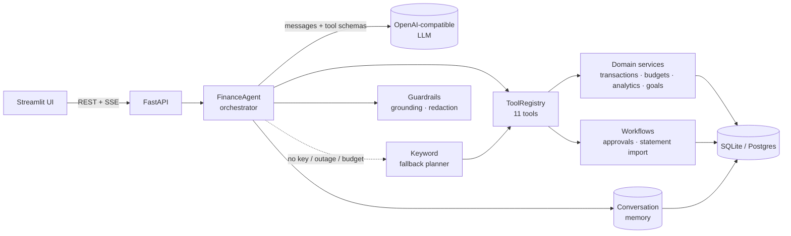

# Personal Finance Agent

[](https://github.com/Parth-Babariya/Personal-Finance-Agent/actions/workflows/ci.yml)


**An AI assistant for your money that answers with your real numbers, and never makes them up.**

Ask in plain language and the agent picks the right tools, queries only your data, and replies with
figures pulled from the database:

```text
You:    Did I spend more on food this month than last month?
Agent:  No. ₹2,558 so far this month vs ₹4,038 in February, ₹1,480 less.

You:    I spent 450 on lunch
Agent:  I'll record a ₹450 food expense for today. This brings food to ₹3,008 of your ₹4,000 budget.
        [Confirm] [Cancel]

You:    Any subscriptions I should know about?
Agent:  5 recurring payments, about ₹19,126/month: rent ₹15,000, electricity ~₹2,360,
        Airtel ₹999, Netflix ₹649, Spotify ₹119.
```

<sub>Examples use the synthetic 3.5-month dataset from the eval suite; every figure above comes from that data.</sub>

Built with **FastAPI**, **SQLAlchemy**, **Streamlit** and any **OpenAI-compatible LLM** (OpenAI, Groq,
Gemini, Ollama). The tool-calling loop is hand-written, with no agent framework.

---

## Highlights

| | |
|---|---|
| 🧠 **Tool-calling agent** | Picks from 11 typed tools, reads their results and writes the answer; multi-step, parallel calls, streaming over SSE |
| ✅ **Measured, not claimed** | 41-case eval suite with ground truth computed from the database: **41/41 pass** on `gpt-oss-120b` |
| 🛡️ **Guardrails** | Runtime number-grounding check, confirm-before-write, PII masking, prompt-injection handling, rate limits, token budget |
| 📊 **Finance features** | Budgets with alerts, trends, unusual-expense detection, subscription detection, savings goals |
| 📥 **Bank statement import** | Upload a CSV; rows are parsed, categorised (rules first, LLM for the rest), de-duplicated and saved only after review |
| 🔌 **Works without an LLM** | A deterministic keyword planner answers with the same tools when no key is set or the provider is down |

---

## Evaluation results

Every case runs on a fresh database seeded with 3.5 months of synthetic transactions. A case passes only if
the right tools were called, forbidden ones were not, and **every expected number appears in the reply**.

| Metric | LLM agent (`gpt-oss-120b` on Groq) | Keyword fallback (no LLM) |
|---|---|---|
| Pass rate | **100%** (41/41) | 85% (35/41) |
| Tool selection accuracy | 100% | 95% |
| Numbers match the database | 100% | 85% |
| Replies passing the runtime grounding check | 98% | 100% |
| Model calls / tokens per question | 1.85 / ~5.1k | 0 |
| Cost per question (Groq paid tier) | ~$0.0009 | free |

By category: summaries 12/12, comparisons 3/3, lookups 5/5, writes 6/6, multi-turn 2/2, planning 6/6,
guardrails 7/7. Full report: [evals/RESULTS.md](evals/RESULTS.md).

**What the eval caught.** The 98% grounding figure is a real catch: in one reply the model wrote ₹6,042
where the tool returned ₹16,042, and the user saw a "couldn't verify" warning. Running the suite against
real models also surfaced four bugs, all fixed:
- false grounding alarms on numbers quoted inside tool text
- users having to confirm a write twice
- provider-side tool-call rejections being treated as outages
- Gemini's thought-signature requirement for tool calls

> Latency in the full report is dominated by free-tier rate-limit waits; unthrottled calls take 2-5 s.

---

## How it works



**One chat turn:**

1. **Mask** card numbers, Aadhaar, PAN, phone numbers and UPI IDs before anything reaches the LLM or the database.
2. If the message is just "yes"/"no" to a pending write, **confirm or cancel it directly**, with no LLM call.
3. Send the system prompt, recent history, the message and the tool schemas to the LLM.
4. **Run requested tools**: validate arguments, inject the user's identity from the JWT (never from the
   model), execute, feed the results back. Repeat until the model answers, within a step budget and deadline.
5. **Ground the answer**: every currency figure must trace back to a tool result. If one doesn't, the model
   gets one corrective retry, and if it still doesn't, the reply carries a visible warning.
6. Save the turn and stream a final `done` event with the tool trace, pending actions and grounding report.

If the LLM is unavailable, times out or the user's daily token budget is used up, the keyword planner
answers instead, unless text has already been streamed or data written.

### Tools

| Tool | What it does |
|---|---|
| `get_spending_summary` | Expenses, income, net and per-category totals for any period or date range |
| `compare_periods` | Two periods side by side, overall and per category |
| `search_transactions` | Filter by text, category, type, amount range and dates |
| `get_top_expenses` | Largest expenses in a period |
| `get_insights` | Rule-based observations: top category, large purchases, savings rate |
| `add_transaction` | *Proposes* an expense or income; saved only after the user confirms |
| `check_budget` | Budget usage, state (ok / warning / over) and month-end projection |
| `get_monthly_trend` | Month-by-month income, expense and net |
| `find_unusual_spending` | Expenses far above the user's norm, each with a reason |
| `find_recurring_payments` | Subscriptions and bills with typical amount and next expected date |
| `get_savings_goals` | Goal progress, required saving per month, on-track status |

---

## Guardrails

| Risk | How it's handled |
|---|---|
| Reading another user's data | `user_id` comes from the JWT through `ToolContext`; it isn't a tool argument, so no prompt can change it |
| Invented numbers | Runtime grounding check on every currency figure, one corrective retry, then a visible warning |
| Wrong transaction from a misread message | Writes become pending actions (15 min expiry) confirmed by "yes" or a button; duplicates and budget impact flagged; max 3 writes per message |
| Bad tool arguments | Pydantic validation (enums, ranges, no future dates); errors, including provider-side rejections, go back to the model to fix |
| Sensitive data sent to the provider | Card (Luhn-checked), Aadhaar, PAN, phone, email/UPI and account numbers masked before the LLM call and storage |
| Prompt injection in bank statements | Descriptions sanitised and treated as data; categoriser output validated; covered by an eval case |
| Runaway loops, slow providers | Step budget with forced final answer, per-step call cap, overall deadline with fallback |
| Abuse and cost | Per-user chat rate limit, per-IP auth limit, login lockout, daily LLM token budget per user |

---

## Quick start

**Requirements:** Python 3.11+ and, optionally, a free LLM key ([Groq](https://console.groq.com/keys) is
the default in `.env.example`).

```bash
git clone https://github.com/Parth-Babariya/Personal-Finance-Agent.git
cd Personal-Finance-Agent
python -m venv .venv
.venv\Scripts\activate            # Windows  (macOS/Linux: source .venv/bin/activate)
pip install -r requirements-dev.txt
copy .env.example .env            # Windows  (macOS/Linux: cp .env.example .env), then paste your key
```

Run the API and the UI in two terminals:

```bash
uvicorn src.api.app:app --port 8003 --reload     # API + interactive docs at http://localhost:8003/docs
streamlit run src/ui/app.py                      # UI at http://localhost:8501
```

No key? Leave `OPENAI_API_KEY` empty and everything still works through the keyword planner.

<details>
<summary><b>Switching LLM provider</b></summary>

All providers use the same OpenAI-compatible client; `.env.example` has a block for each. Keep exactly one
block uncommented (if a variable appears twice, the last one wins).

| Provider | `OPENAI_BASE_URL` | Example model |
|---|---|---|
| Groq (default) | `https://api.groq.com/openai/v1` | `openai/gpt-oss-120b` |
| OpenAI | *(leave empty)* | `gpt-4o-mini` |
| Gemini | `https://generativelanguage.googleapis.com/v1beta/openai/` | `gemini-3.8-flash` |
| Ollama (local) | `http://localhost:11434/v1` | `llama3.1` |

Variables already set in your shell override `.env`.
</details>

<details>
<summary><b>Production settings</b></summary>

- `APP_ENV=production`: the app refuses to start without `JWT_SECRET_KEY`
- `DATABASE_URL=postgresql+psycopg://...`, `AUTO_CREATE_TABLES=false`, then `alembic upgrade head`
- Tune `CHAT_REQUESTS_PER_MINUTE`, `DAILY_TOKEN_BUDGET`, `AGENT_TIMEOUT_SECONDS` and the others in `.env.example`
- The rate limiter is in-process; use a shared store such as Redis when running several API replicas
</details>

---

## API

Interactive docs at `/docs` once the API is running. Main endpoints (all under `/api/v1`, JWT required
except auth):

| Area | Endpoints |
|---|---|
| Auth | `POST /auth/signup`, `POST /auth/login` |
| Chat | `POST /chat`, `POST /chat/stream` (SSE: `tool_call`, `tool_result`, `token`, `reset`, `done`), `GET`/`DELETE /chat/history` |
| Confirmations | `GET /actions`, `POST /actions/{id}/confirm`, `POST /actions/{id}/cancel` |
| Transactions | `POST`/`GET /transactions` (filters, pagination), `GET`/`PATCH`/`DELETE /transactions/{id}`, `GET /summary` |
| Budgets | `GET /budgets`, `PUT`/`DELETE /budgets/{category}`, `GET /budgets/status` |
| Analytics | `GET /analytics/trend`, `GET /analytics/unusual`, `GET /analytics/recurring` |
| Goals | `GET`/`POST /goals`, `POST /goals/{id}/contributions`, `DELETE /goals/{id}` |
| Statement import | `POST /imports` (CSV upload → preview), `POST /imports/{id}/commit`, `GET`/`DELETE /imports/{id}` |

---

## Testing and evaluation

```bash
pytest --cov                                     # 221 tests, 96% coverage (in-memory DB, fake LLM, mocked HTTP)
ruff check src tests evals migrations            # lint
python -m evals.run_eval --mode fallback         # eval without an API key
python -m evals.run_eval --mode both --write-results            # full eval, updates evals/RESULTS.md
python -m evals.run_eval --mode both --resume --write-results   # continue after a free-tier quota stop
```

CI runs lint, tests with coverage, an Alembic check that migrations match the models, and the fallback eval
on every push.

Eval runs are resumable: each finished case is checkpointed, and resuming is refused if the model, endpoint,
cases or agent code changed, so results from different setups can never be mixed.

---

## Project structure

```text
src/
├── agents/        orchestrator (finance_agent.py), keyword fallback planner, prompts
├── tools/         base classes, registry, and tools grouped by domain
├── llm/           OpenAI-compatible provider client
├── guardrails/    grounding check, PII redaction, rate limiting
├── memory/        per-user conversation history
├── workflows/     write approvals (human in the loop), statement import, categorisation
├── services/      domain logic: transactions, budgets, analytics, goals, auth, usage, insights
├── db/            engine/session and ORM models
├── core/          settings, security helpers, shared domain types
├── interfaces/    abstract contracts
├── api/           FastAPI app factory, routes, schemas, dependencies
└── ui/            Streamlit client
evals/             synthetic dataset, cases with DB-derived ground truth, resumable runner
migrations/        Alembic
tests/
```

Dependencies point inward (`api → agents → tools / guardrails / memory / workflows → services → db / core`),
so the finance logic works and is tested without any LLM.

---

## Roadmap

- [ ] Docker Compose (API, UI, Postgres)
- [ ] Structured logging and an audit log of agent writes
- [ ] Pinned dependency lockfile
- [ ] Hosted demo
